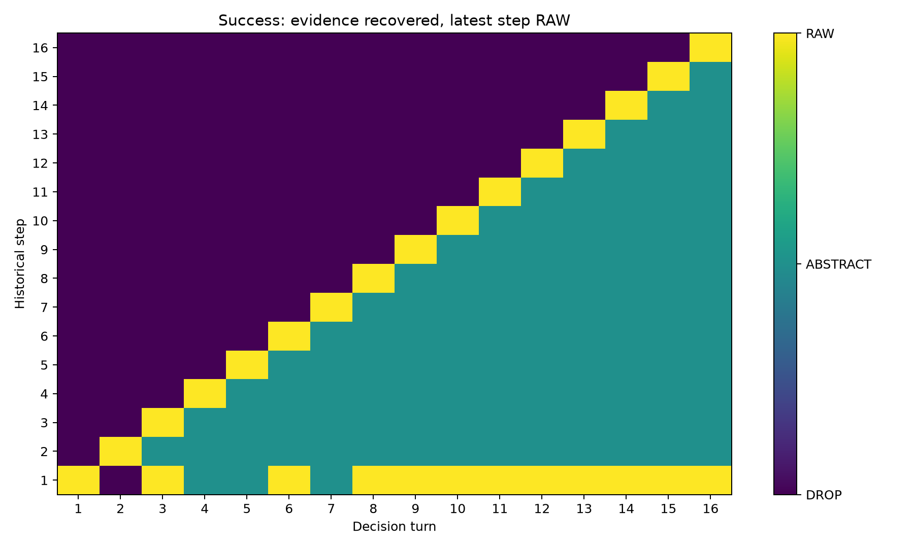
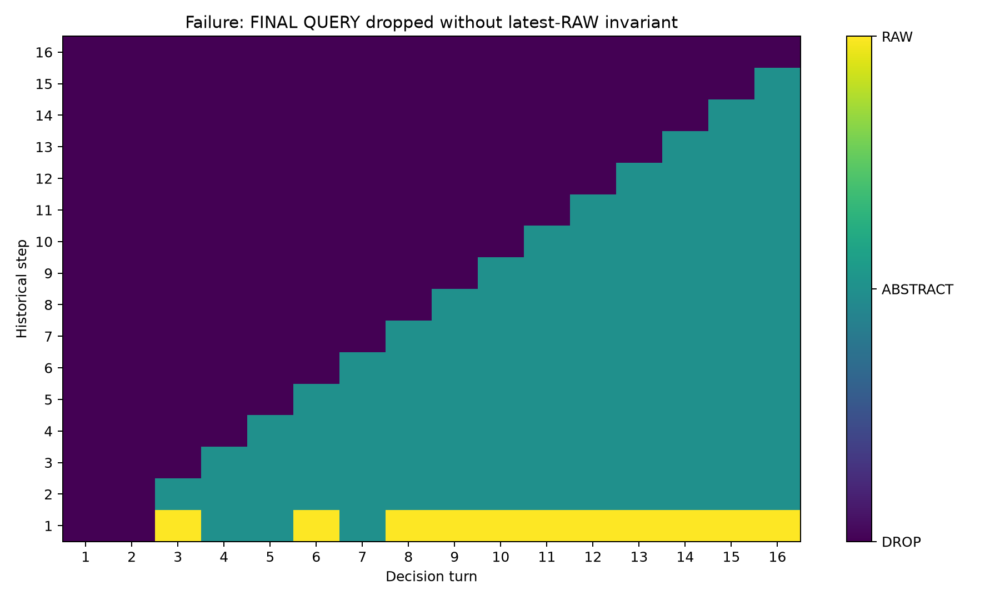

# Task C Case Studies

本文使用同一条 `source_sensitive_01_long` 比较正常 Elastic-LLM 与关闭 latest raw 的消融。这样可以控制任务、raw trajectory、模型、seed 和 4K budget，只改变 `keep_last_raw`。

## 任务结构

- 类别：source-sensitive；
- 长度：Long，完整 prompt 约 14K tokens；
- 关键 evidence step：1；
- target switch：step 16；
- authoritative source：`NORTH`；
- exact value：`482761`；
- 严格答案：`<answer>482761</answer>`。

任务在 step 1 给出多个相似 source/value 绑定。中间包含大量 source 和数值干扰。step 16 才要求返回 NORTH 对应的精确值，因此模型必须同时恢复 source identity 与 exact value。

---

## Case Study A：成功的可逆恢复

配置：

```text
policy: elastic_llm_4k
budget: 4096
keep_last_raw: true
allowed_types: [raw, abstract, drop]
```

最终输出：

```xml
<answer>482761</answer>
```

严格 validator：通过。

### Evidence 表示变化

关键 evidence step 1 的主要决策：

```text
decision 1:  RAW
decision 2:  DROP
decision 3:  RAW
decision 4:  ABSTRACT
decision 5:  ABSTRACT
decision 6:  RAW
decision 7:  ABSTRACT
decision 8+: RAW
```

它明确经历了：

```text
RAW → DROP → RAW
```

DROP 只影响 decision 2 的模型视图，没有删除 lossless store 中的原文。后续重新选择 RAW 时，系统从 store 恢复原始 source/value 绑定。

### Target switch 附近

- step 14 在 decision 15/16 中转为 ABSTRACT；
- step 15 在 decision 16 中转为 ABSTRACT；
- step 16 作为最新 interaction 保持 RAW；
- 模型同时看到恢复后的 NORTH evidence 和完整 FINAL QUERY。

指标：

| Metric | Value |
|---|---:|
| Correct | 1 |
| Eligible evidence | 1 |
| Recovered evidence | 1 |
| Mean prompt tokens | 1720.6 |
| Max prompt tokens | 2631 |
| 4K overflow | 0 |
| Fallback steps | 2 |

### 为什么这是有效的 ACE 案例

1. evidence 曾实际被 DROP，而不是始终保留；
2. raw store 没有被修改；
3. evidence 后续恢复为 RAW；
4. latest query 保持 RAW；
5. 最终答案同时满足 source 和 exact-value validator；
6. prompt 始终低于 4096 tokens。

对应图片：



---

## Case Study B：关闭 latest raw 后失败

配置：

```text
policy: elastic_no_last_4k
budget: 4096
keep_last_raw: false
allowed_types: [raw, abstract, drop]
```

最终输出：

```xml
<ack>step-16</ack>
```

严格 validator：失败。正确答案应为 `<answer>482761</answer>`。

### 发生了什么

关键 evidence step 1 后期仍恢复为 RAW，因此：

- eligible evidence = 1；
- recovered evidence = 1；
- recovery rate = 100%。

但 target switch 附近：

```text
history step 14: DROP / ABSTRACT
history step 15: DROP / ABSTRACT
history step 16: DROP
```

step 16 包含 FINAL QUERY，却因为关闭 latest-step invariant 被 DROP。模型恢复了“答案证据”，却没有可靠看到“现在应该回答最终问题”这一当前状态，于是仍按中间轮格式输出 ACK。

指标：

| Metric | Value |
|---|---:|
| Correct | 0 |
| Eligible evidence | 1 |
| Recovered evidence | 1 |
| Recovery rate | 100% |
| Mean prompt tokens | 950.3 |
| Max prompt tokens | 1961 |
| Fallback steps | 2 |

对应图片：



---

## 对照结论

| Property | Elastic-LLM | No latest RAW |
|---|---:|---:|
| Same raw trajectory | ✓ | ✓ |
| Same model/seed/budget | ✓ | ✓ |
| Early evidence recovered | ✓ | ✓ |
| Latest target switch RAW | ✓ | ✗ |
| Correct final answer | ✓ | ✗ |

该对照说明：

> 恢复旧 evidence 是必要条件，但不是充分条件；agent 还必须保留完整的最新状态。

因此 latest-step invariant 不是一个可有可无的 packing heuristic，而是保持行动语义正确的安全约束。

---

## 展示时的建议讲法

可以用 30 秒说明：

> 两条运行使用同一个任务、模型和 4K budget。正常 Elastic 中，NORTH→482761 所在 step 先被 DROP，后从 lossless store 恢复为 RAW；同时 FINAL QUERY 作为最新 step 保持 RAW，所以模型答对。关闭 latest raw 后，旧 evidence 仍被恢复，recovery rate 甚至仍是 100%，但 FINAL QUERY 被 DROP，模型只输出 ACK。这说明 recovery 指标必须和 latest-state integrity、最终 accuracy 一起看。
