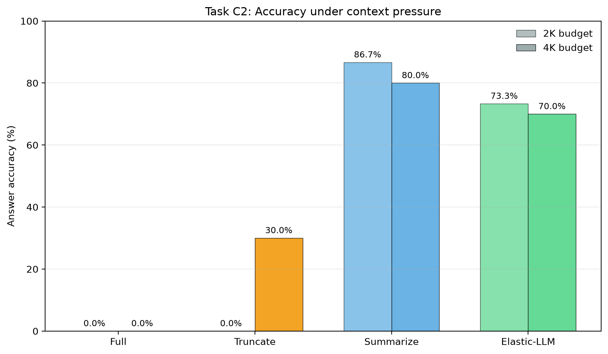
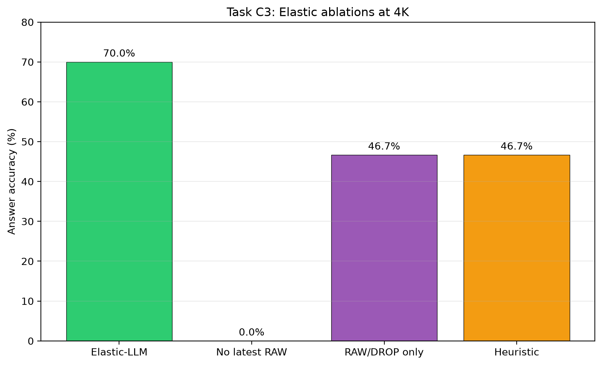
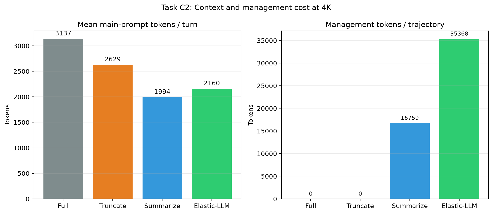
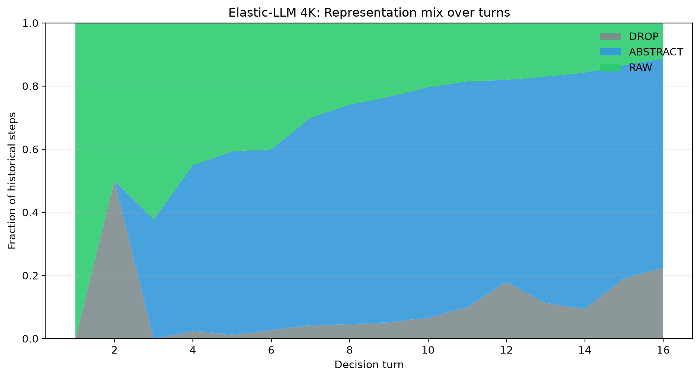
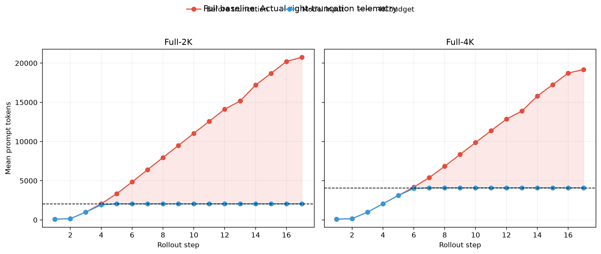

# Task C Benchmark

本目录实现 30 条 deterministic delayed-evidence 任务：5 类 × short/long × 3。C1、C2 与 C3 共用同一冻结数据集。
人工审阅请打开 `data/task_c/cases/`，其中每条任务对应一个格式化 JSON；`cases.jsonl` 仅供程序批量读取。

## 构建

```bash
python -m benchmarks.task_c.build \
  --output-dir data/task_c \
  --model /root/autodl-tmp/models/Qwen2.5-3B-Instruct
```

冻结 manifest：30 条，short 8K–12K、long 12K–16K，`cases_sha256=cbe9231d1715ce7d4fc80986f07fa35a1e08a5db0a6942a05feb9f9bc9b6f7bc`。

## 运行

```bash
# 先查看完整矩阵命令
python -m benchmarks.task_c.run_experiments --dry-run

# 运行 C2 + C3 + Full-20k Oracle
python -m benchmarks.task_c.run_experiments \
  --model-path /root/autodl-tmp/models/Qwen2.5-3B-Instruct

# 隔离运行一个样例，不覆盖正式 benchmark
python -m benchmarks.task_c.run_experiments \
  --case-id exact_number_01_short \
  --run elastic_heuristic_4k \
  --model-path /root/autodl-tmp/models/Qwen2.5-3B-Instruct
```

正式结果写入 `outputs/task_c/{raw,audit,store,metrics,manifests}`；单样例写入 `outputs/task_c_trial/`。2K/4K 是实际 prompt 上限，512 output tokens 单独预留。

## 评分与绘图

```bash
python -m benchmarks.task_c.evaluate --cases data/task_c/cases.jsonl --output outputs/task_c/raw/elastic_llm_4k.jsonl --policy elastic_llm_4k --budget 4096 --output-dir outputs/task_c/metrics/elastic_llm_4k
python -m benchmarks.task_c.plot_timeline --per-step outputs/task_c/metrics/elastic_llm_4k/per_step.jsonl --case-id exact_number_01_short --output outputs/task_c/plots/elastic_llm_4k_exact_number_01_short.png
```


## 架构

```text
Environment/tool raw truth ──► memory, reward, done, full logger
             │
             └─► LosslessStore ─► abstraction cache
                                      │
                                      ▼
                         RAW / ABSTRACT / DROP
                                      │
                                      ▼
                         tokenizer-aware packing
                                      │
                                      ▼
                         model-visible context view
```

ACE 只改变每次 generation 前的 context view，不覆盖 `EnvironmentManager.memory`，也不改变工具执行、reward 或 ground truth。摘要、编排和主生成串行复用同一个 rollout worker。

## Context policy 配置

| 字段 | 默认值 | 含义 |
|---|---:|---|
| `mode` | `full` | `full/truncate/summarize/elastic` |
| `max_input_tokens` | 4096 | 实际主模型 prompt 上限 |
| `reserve_output_tokens` | 512 | 单独预留的输出长度 |
| `keep_last_raw` | true | 强制最近完整 interaction 为 RAW |
| `abstraction_cache` | true | 按 source hash 缓存逐 step 摘要 |
| `orchestration` | `llm` | LLM 或 deterministic heuristic |
| `truncate_window_steps` | 4 | 固定窗口保留步数 |
| `abstraction_max_tokens` | 256 | 摘要最大输出 |
| `orchestration_max_tokens` | 512 | 编排最大输出 |
| `allowed_types` | all | 消融时可禁用 ABSTRACT 等类型 |
| `audit_dir/store_dir` | null | 审计和 lossless JSONL 路径 |

Budget 语义：

```text
actual_prompt_tokens <= max_input_tokens
actual_prompt_tokens + reserve_output_tokens <= model_context_window
```

## 一键运行与断点续跑

```bash
# 完整 C2 + C3 + Oracle；本机 Ray 建议显式使用 local
RAY_ADDRESS=local python -m benchmarks.task_c.run_experiments \
  --batch-size 30 \
  --model-path /root/autodl-tmp/models/Qwen2.5-3B-Instruct

# 中断后只运行缺失配置
RAY_ADDRESS=local python -m benchmarks.task_c.run_experiments \
  --resume --batch-size 30 \
  --model-path /root/autodl-tmp/models/Qwen2.5-3B-Instruct

# 只运行指定配置
RAY_ADDRESS=local python -m benchmarks.task_c.run_experiments \
  --run elastic_llm_4k --batch-size 30 \
  --model-path /root/autodl-tmp/models/Qwen2.5-3B-Instruct
```

## Full truncation telemetry

每个 structured trajectory record 包含：

```json
{
  "truncation_telemetry": {
    "pre_truncation_tokens": 14208,
    "post_truncation_tokens": 2048,
    "truncation_direction": "right",
    "truncated_tokens": 12160,
    "was_truncated": true
  }
}
```

这些字段在 tokenizer 截断点只读采集，不改变 Full 的 prompt 或 backend 行为。聚合 CSV 报告 truncation event count、累计丢失 tokens 和最大截断前长度。

## 生成全部图表

```bash
python -m benchmarks.task_c.plot_results \
  --metrics-dir outputs/task_c/metrics \
  --raw-dir outputs/task_c/raw \
  --output-dir outputs/task_c/plots
```

输出：

- `c2_accuracy.png`
- `c3_ablations.png`
- `token_costs_4k.png`
- `elastic_types_over_turn.png`
- `full_truncation_telemetry.png`
- 两个 case timeline PNG

两个详细案例见 [CASE_STUDIES.md](CASE_STUDIES.md)，slides 草稿见 [TASK_C_SLIDES.md](TASK_C_SLIDES.md)，实现与答辩说明见 [IMPLEMENTATION_AND_DEFENSE_NOTES.md](IMPLEMENTATION_AND_DEFENSE_NOTES.md)。

## 测试

```bash
python benchmarks/task_c/test_task_c.py
python benchmarks/task_c/test_alphaapollo_smoke.py
```

如果已安装 pytest：

```bash
python -m pytest ace_context/tests benchmarks/task_c -q
```

## 失败回退与 replay

- abstraction JSON 无效或字段缺失：生成 deterministic fallback abstraction；
- orchestration JSON/step/type 非法：使用 deterministic heuristic；
- fixed prompt 或 latest raw 超预算：抛出明确错误，不允许静默截断；
- store 采用 source hash 失效缓存；
- audit 保存最终 message hash、type decision、token 和 fallback；
- replay 不调用环境即可重建记录的 context view。

## 实验结果摘要

| Policy | 2K | 4K |
|---|---:|---:|
| Full | 0.0% | 0.0% |
| Truncate | 0.0% | 30.0% |
| Summarize | 86.7% | 80.0% |
| Elastic-LLM | 73.3% | 70.0% |

Full-20K Oracle 为 93.3%。当前 benchmark 上 Summarize 高于 Elastic；Elastic 的主要验证点是可逆 recovery、严格 budget、逐 step 审计和消融可解释性，而不是宣称所有条件下 accuracy 最优。


## 已生成图表

### C2 accuracy



### C3 ablations



### Token cost



### Elastic types over turns



### Full truncation telemetry



正式 telemetry 汇总：

| Run | Records | Truncated turns | Lost tokens | Max pre-truncation | Direction |
|---|---:|---:|---:|---:|---|
| Full-2K | 450 | 354 | 3,029,426 | 20,895 | right |
| Full-4K | 450 | 294 | 2,020,893 | 19,878 | right |
| Full-20K Oracle | 450 | 0 | 0 | 15,562 | none |

三个 Full 配置均以 `batch_size=30` 重跑。manifest 记录的 wall time 分别为 257.3s、348.5s 和 312.3s，峰值 GPU memory 分别为 19,210 MB、19,280 MB 和 18,992 MB。wall time 包含 Ray 和模型启动成本，且只有一次运行，因此不报告方差或显著性。
